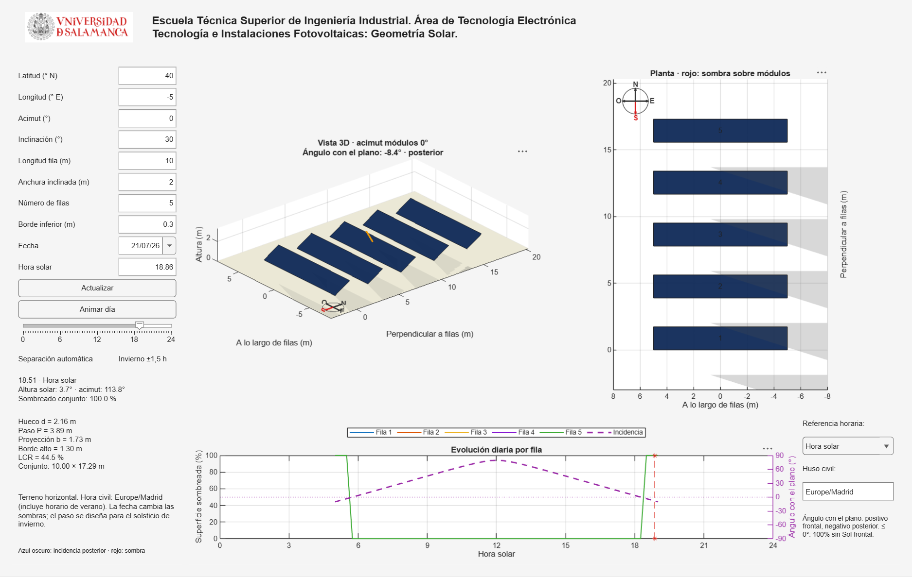

# Geometría Solar — Filas fotovoltaicas en MATLAB

Visualizador didáctico de la disposición de filas fotovoltaicas y la evolución
de sus sombras durante un día. Permite relacionar inclinación, acimut, geometría
solar, separación entre mesas y cobertura horizontal del terreno.

**Tecnología e Instalaciones Fotovoltaicas: Geometría Solar.**

Escuela Técnica Superior de Ingeniería Industrial. Área de Tecnología Electrónica.
Universidad de Salamanca.



## Inicio rápido

1. Descarga el repositorio como ZIP y descomprímelo, o clónalo:

   ```bash
   git clone https://github.com/estebanbejar/geometria_solar.git
   ```

2. Abre MATLAB, entra en la carpeta del repositorio y ejecuta:

   ```matlab
   run('examples/demo_filas.m')
   ```

También puedes añadir `src` al path y ejecutar `pv_filas_visualizador`.
No requiere Internet ni toolboxes adicionales. La versión inicial se ha
verificado en **MATLAB R2026a en Windows**. Utiliza componentes de interfaz
modernos (`uifigure`, `uigridlayout`, `uidatepicker`); otras versiones no se han
verificado.

## Qué permite explorar

- Configurar ubicación, acimut, inclinación, dimensiones reales de las mesas,
  número de filas y altura del borde inferior.
- Elegir fecha en el calendario, recorrer las horas o animar el día.
- Observar sombras sobre el terreno y sobre las filas en perspectiva y planta.
- Consultar posición solar, ángulo con el plano del módulo, separación y LCR.
- Comparar superficie sombreada por fila y ángulo con el plano en una gráfica
  diaria con dos escalas.
- Alternar hora solar y civil, conservando el instante seleccionado.

## Convenciones

| Magnitud | Definición |
|---|---|
| Latitud | Norte positivo, Sur negativo; interfaz entre −65° y +65° |
| Longitud | Este positivo, Oeste negativo |
| Acimut de los módulos | Dirección de la cara frontal: 0° Sur, Este negativo, Oeste positivo; −90° a +90° |
| Inclinación | Respecto a la horizontal; 0° a 45° |
| Longitud de fila | Dimensión real a lo largo del eje longitudinal |
| Anchura inclinada | Dimensión real transversal, medida sobre el plano de módulos |
| Ángulo con el plano | 90° perpendicular, 0° rasante; negativo para incidencia posterior |
| Hueco libre | Distancia horizontal perpendicular entre bordes de mesas consecutivas |
| Paso | Distancia entre puntos homólogos de filas consecutivas |
| LCR | Proyección horizontal de los módulos / terreno del patrón repetitivo |

La interfaz comienza en 40° N, 5° O, acimut 0°, inclinación 30°, mesas de
10 × 2 m, cinco filas y borde inferior a 0,30 m. La fecha inicial es el 21 de
diciembre del año actual y la hora solar inicial es 12:00.

**Separación automática:** ausencia de sombras durante tres horas totales
(±1,5 horas del mediodía solar) en el solsticio de invierno. Cambiar la fecha
del calendario modifica las sombras, no el criterio de dimensionamiento.

## Lectura de las vistas

Azul claro representa módulos con incidencia frontal; rojo representa la
superficie cubierta por sombras de otras filas. Azul oscuro indica que el Sol
incide por detrás. La flecha amarilla apunta hacia el Sol. Las rosas muestran
N/E/S/O y destacan el Sur en rojo. Las coordenadas de las vistas son locales,
ligadas a las filas; la planta está girada 90° en sentido antihorario.

En la curva izquierda, **100% también significa cara frontal sin iluminación
directa** cuando el ángulo con el plano es cero o negativo. Es una convención
didáctica: no equivale necesariamente a una sombra geométrica entre filas.
La curva morada y el eje derecho muestran el ángulo firmado con el plano.
Por la noche se omiten ambas curvas.

La hora civil utiliza por defecto `Europe/Madrid`; se puede introducir otro
huso IANA, por ejemplo `Atlantic/Canary`. Incluye longitud, ecuación del tiempo
aproximada y horario de verano. Consulta los detalles en el
[manual de uso](docs/manual.md).

## Modelo y límites

Filas completas, paralelas, iguales y alineadas; terreno horizontal. Las sombras
consideran la longitud finita de las mesas. La declinación solar y la ecuación
del tiempo se aproximan analíticamente. No se calculan irradiación, producción,
pérdidas eléctricas, bypass, difusión ni respuesta bifacial. El propósito es
docente; para simulación energética detallada se utiliza una herramienta como
PVsyst.

El diseño de separación parte de filas largas. Una ventana de invierno con el
Sol bajo el horizonte se rechaza con un aviso. La orientación frontal se define
siempre desde el Sur, también al introducir una latitud austral. Consulta las
[ecuaciones y límites del modelo](docs/modelo.md).

## Archivos y verificación

```text
src/pv_filas_visualizador.m  Interfaz, vistas y animación
src/pv_filas_modelo.m        Geometría, posición solar y sombras
src/pv_hora_solar.m          Conversión solar/civil
examples/demo_filas.m       Lanzador
examples/verificar_filas.m  Comprobaciones geométricas y de interfaz
assets/usal.png             Logo aportado para la interfaz
docs/                      Manual, ecuaciones e imágenes
```

Para ejecutar las comprobaciones:

```matlab
run('examples/verificar_filas.m')
```

Se verifican la separación de referencia, ausencia de sombras en la ventana
protegida, sombras fuera de ella, simetría Este/Oeste, mesas horizontales, una
sola fila, incidencia posterior en verano, noche, conversión horaria y apertura
de la interfaz.

## Licencia y atribución

El código se distribuye bajo la [licencia MIT](LICENSE), conservando la
atribución original a Esteban Sánchez. El logo USAL se incluye como identificación
institucional; la licencia del código no otorga derechos sobre esa marca.
