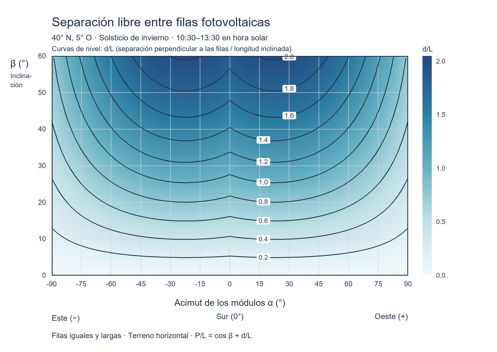
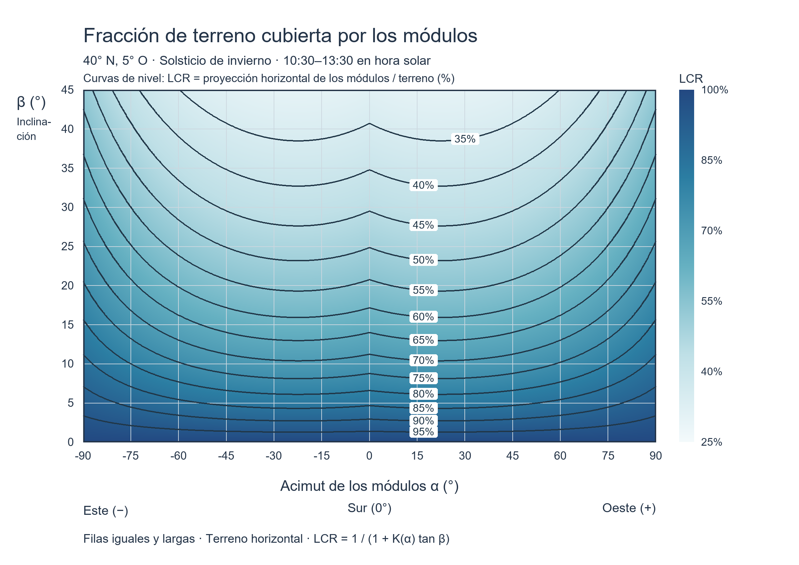

# Fundamento geométrico

## Separación y cobertura

Sea $L$ la anchura inclinada de la mesa, $\beta$ su inclinación, $\alpha$ su
acimut frontal, $\gamma_s$ la altura solar y $a_s$ el acimut solar. Ambos acimuts
se miden desde el Sur, negativos hacia Este y positivos hacia Oeste.

$$b=L\cos\beta,\qquad H=L\sin\beta.$$

La sombra relevante para separar filas es su componente perpendicular al eje
longitudinal. El factor de diseño es:

$$K(\alpha)=\max_{\omega\in[-22.5^\circ,22.5^\circ]}
\frac{\max(0,\cos[a_s(\omega)-\alpha])}{\tan\gamma_s(\omega)}.$$

El ángulo horario $\omega=15^\circ(t_s-12)$ corresponde a hora solar $t_s$.
La declinación de diseño es −23,44° en latitudes norte y +23,44° en latitudes sur.
El máximo se evalúa en 1.801 puntos durante las tres horas de invierno.

$$d=HK,\qquad P=b+d,\qquad
LCR=\frac{b}{P}=\frac{1}{1+K\tan\beta}.$$

LCR utiliza el área **horizontal proyectada**, no el área inclinada de módulos.
Es la cobertura del patrón de filas, sin pasillos ni perímetro. La altura común
de los bordes inferiores se cancela en el dimensionamiento de mesas iguales.

La primera figura contextualiza el estudio inicial hasta 60°; la interfaz final
restringe la inclinación a 45°. Ambas figuras corresponden a 40° N y solsticio
de invierno.

## Vector solar

Con latitud $\phi$, declinación $\delta$ y ángulo horario $\omega$:

$$s_S=\sin\phi\cos\delta\cos\omega-\cos\phi\sin\delta,$$
$$s_O=\cos\delta\sin\omega,$$
$$s_Z=\sin\phi\sin\delta+\cos\phi\cos\delta\cos\omega.$$

Los ejes locales son $x$ hacia el borde alto de la mesa, $y$ a lo largo de la
fila hacia la dirección de acimut $\alpha+90^\circ$, y $z$ vertical:

$$s_x=-s_S\cos\alpha-s_O\sin\alpha,\qquad
s_y=s_O\cos\alpha-s_S\sin\alpha,\qquad s_z=s_Z.$$

La aproximación anual implementada es
$\delta=-23.44^\circ\cos[360^\circ(n-355)/365.2422]$, donde $n$ es el día del año.
La altura es $\arcsin s_z$ y el acimut se obtiene con $\operatorname{atan2}(s_O,s_S)$.

## Ángulo con el plano e incidencia posterior

La normal frontal unitaria local es
$\mathbf n=(-\sin\beta,0,\cos\beta)$. El visualizador utiliza el ángulo firmado:

$$\eta=\arcsin(\mathbf s\cdot\mathbf n).$$

Así, $\eta=90^\circ$ significa incidencia perpendicular; $\eta=0^\circ$, rasante;
y $\eta<0^\circ$, incidencia posterior. Es el complemento firmado del ángulo
con la normal: $\eta=90^\circ-\theta_n$.

Si el Sol está sobre el horizonte y $\eta\leq0$, se asigna 100% al indicador
didáctico de cara frontal sin iluminación directa. El sombreado geométrico se
conserva separadamente. Con el Sol bajo el horizonte, los indicadores y el ángulo
se devuelven como `NaN`.

## Proyección y sombras

Un vértice $\mathbf v$ proyectado a un plano de normal $\mathbf n$ que pasa por
$\mathbf o$, siguiendo rayos opuestos al Sol, queda en:

$$\mathbf q=\mathbf v-\lambda\mathbf s,\qquad
\lambda=\frac{(\mathbf v-\mathbf o)\cdot\mathbf n}{\mathbf s\cdot\mathbf n}.$$

Solo se consideran proyecciones con $\lambda>0$. Como las mesas son paralelas,
$\lambda$ es constante para los vértices de una mesa emisora respecto a una
mesa receptora. El polígono proyectado se intersecta con el rectángulo receptor;
se unen las sombras de todas las emisoras para evitar doble contabilización.
Su área dividida por $LW$ es la fracción geométrica sombreada. Para proyectar
al suelo se usa $\mathbf q=\mathbf v-(v_z/s_z)\mathbf s$.

## Hora civil

$$t_s=t_c-\Delta_{UTC}+\frac{\ell}{15^\circ}+\frac{E}{60},$$

donde $\ell$ es longitud Este positiva, $\Delta_{UTC}$ es el desfase civil en
horas y $E$ la ecuación del tiempo en minutos. Se usa:

$$B=\frac{2\pi(n-81)}{364},\qquad
E=9.87\sin(2B)-7.53\cos B-1.5\sin B.$$

El desfase procede de `datetime` y `tzoffset` con el huso IANA seleccionado.
La declinación y la ecuación del tiempo se mantienen constantes durante cada día.

## Referencias

- [PVsyst: modelo bidimensional de sombreado entre filas y ángulo de perfil](https://www.pvsyst.com/help/project-design/orientations-in-v8/sheds-mutual-shadings.html).
- [MATLAB: zonas horarias](https://www.mathworks.com/help/matlab/matlab_prog/specify-time-zones.html).
- [MATLAB: operaciones geométricas con polyshape](https://www.mathworks.com/help/matlab/ref/polyshape.html).

Las aproximaciones solares se explicitan aquí para facilitar su lectura docente;
no implementan un algoritmo de efemérides de alta precisión.
