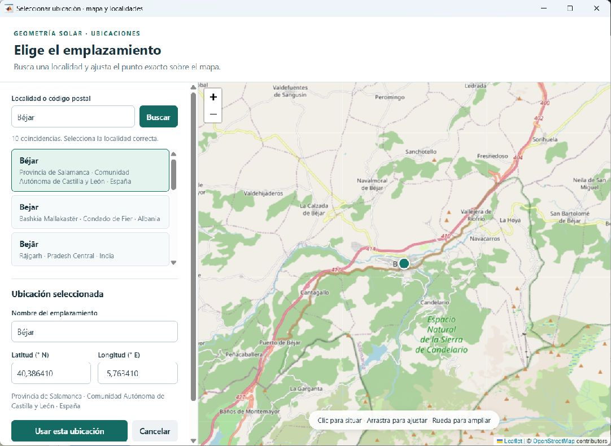

# Selector de ubicación

El selector permite encontrar localidades por nombre o código postal, elegir
la coincidencia por región y país y ajustar el punto en el mapa. El nombre del
emplazamiento se puede editar. **Usar esta ubicación** devuelve el nombre y
las coordenadas; **Cancelar** conserva los valores anteriores.



La búsqueda encuentra localidades, no direcciones completas. Al mover el
marcador se conserva el nombre como etiqueta editable; el selector no realiza
geocodificación inversa. Si se editan las coordenadas directamente en el
visualizador, el nombre pasa a **Punto personalizado**.

El componente está en `assets/location_picker` y MATLAB lo abre mediante
`uihtml`. La interfaz de eventos requiere MATLAB R2023a o posterior; el proyecto
se ha verificado en MATLAB R2026a para Windows. No necesita Mapping Toolbox ni
Python.

Las imágenes del mapa se solicitan a OpenStreetMap para el área visible y se
guardan durante siete días en `data/map_tiles`. La búsqueda se envía a Open-Meteo
/ GeoNames solo cuando se pulsa **Buscar**. Si falla la conexión, se pueden
seguir introduciendo las coordenadas manualmente. Se distribuye Leaflet 1.9.4
localmente; su licencia BSD está en
[`assets/location_picker/vendor/LICENSE`](../assets/location_picker/vendor/LICENSE).

## Uso desde MATLAB

```matlab
addpath('src');
[lat,lon,aceptado,nombre] = seleccionar_ubicacion(40,-5, ...
    Nombre="Mi instalación",LatitudeLimits=[-65 65]);
```

El componente general acepta latitudes entre −90° y +90° y longitudes entre
−180° y +180°. El visualizador limita la latitud a ±65° porque el mapa usa la
proyección de Mercator.
